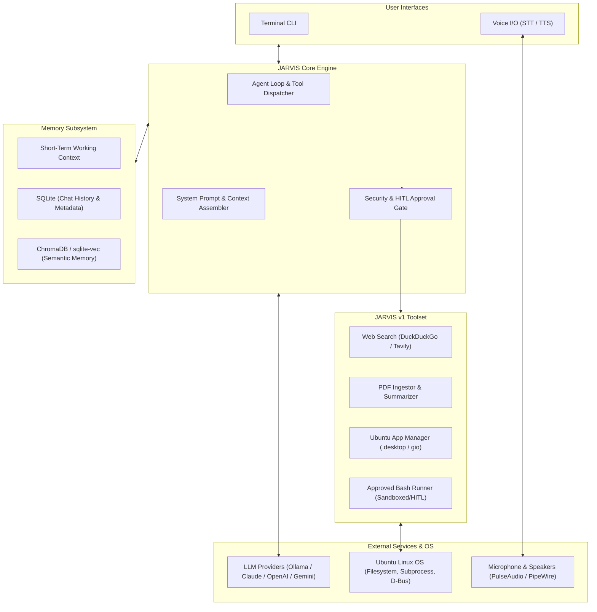
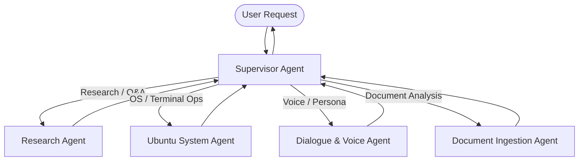

# JARVIS Architecture Specification

This document details the architectural blueprint of **JARVIS v1: A Personal AI Agent for Ubuntu**, and outlines its planned evolution toward a multi-agent system.

---

## 1. System Overview

JARVIS is designed as an extensible, modular personal AI agent operating natively in Ubuntu Linux environments. It integrates conversational reasoning with system-level actuators, information retrieval pipelines, multimodal voice I/O, and persistent memory.

---

## 2. Core Architectural Principles

1. **Agent State Persistence across Chats:** All architectural decisions, state transitions, tool interfaces, and configurations are explicitly documented in markdown files (`PROJECT_STATE.md`, `ARCHITECTURE.md`, `PHASES.md`). Any AI agent opening a fresh chat can resume work without loss of context.
2. **Human-in-the-Loop (HITL) Execution Safety:** Terminal command execution must NEVER run arbitrary commands without strict risk categorization and interactive user confirmation for commands that modify state.
3. **Provider-Agnostic LLM Interface:** The system connects to LLMs via an abstraction layer, supporting local open-weights models (via Ollama or vLLM) and commercial APIs (Claude, OpenAI, Gemini).
4. **Ubuntu-Native Tooling:** OS control leverages native Linux conventions: inspecting `/usr/share/applications` and `~/.local/share/applications` for `.desktop` metadata, launching via `gio launch` / `gtk-launch`, and executing shell commands via clean subprocess pipelines.
5. **Low-Latency Voice Pipeline:** Audio capture, Voice Activity Detection (VAD), Speech-to-Text (STT), and Text-to-Speech (TTS) run locally or via low-latency streams without blocking agent reasoning.

---

## 3. Subsystem Breakdown

### 3.1 LLM Abstraction & Agent Engine
- **Interface:** `BaseLLMClient` with implementations for `OpenAIClient`, `AnthropicClient`, `OllamaClient`, `GeminiClient`.
- **Reasoning Format:** Structured Tool Calling (function calling) with clear JSON arguments.
- **Agent Loop:**
  1. Receive user input (text or transcribed voice).
  2. Retrieve relevant memory (past conversations + relevant vector memories).
  3. Formulate prompt with system persona, available tools, and guidelines.
  4. Invoke LLM.
  5. If tool calls are requested:
     - Check safety/approval level for each tool.
     - Execute approved tools or request user confirmation via terminal/voice.
     - Return tool outputs to LLM.
  6. Deliver response to user (console + TTS).
  7. Persist session dialogue and memory embeddings.

### 3.2 Memory Subsystem
- **Short-Term Context:** Sliding-window context buffer maintaining the current active conversation. Summarizes older turns when token thresholds are reached.
- **Long-Term Relational Memory (SQLite):**
  - Table: `sessions` (id, title, created_at, updated_at)
  - Table: `messages` (id, session_id, role, content, tool_calls, timestamp)
  - Table: `facts` (id, entity, relation, value, confidence, timestamp)
- **Semantic Memory (ChromaDB / Vector Index):**
  - Embedded past dialogues and key extracted user preferences/facts.
  - Allows answering questions like: *"What was the PDF I asked you about last Tuesday?"*

### 3.3 Information Retrieval (Search & Documents)
- **Web Search Tool (`web_search`):**
  - DuckDuckGo Search API / Tavily API.
  - Returns sanitized search snippets, titles, URLs, and optional deep-page extraction for top results.
- **PDF Ingestion & Summarization Tool (`pdf_reader`):**
  - Extract text and metadata using `pypdf` / `pymupdf`.
  - Automatic chunking with recursive character splitting.
  - Two operational modes:
    - *Full Document Summarization:* Map-reduce or hierarchical summaries for documents fitting within model limits.
    - *Targeted Q&A (RAG):* Query chunk embeddings to answer specific questions inside 100+ page documents.

### 3.4 Ubuntu Desktop & Shell Integration
- **App Launcher (`app_manager`):**
  - Scans installed applications from `/usr/share/applications` and `~/.local/share/applications`.
  - Indexes app names, descriptions, exec commands, and categories.
  - Fuzzy-matches natural language queries (e.g. *"open chrome"*, *"launch spotify"*, *"open settings"*) to exact `.desktop` IDs.
  - Launches apps cleanly detached from the agent process via `gio launch <app.desktop>` or `gtk-launch`.
- **Approved Terminal Command Runner (`terminal_runner`):**
  - Safety classification:
    - **Safe / Read-Only (Auto-run allowed or prompt optional):** `ls`, `cat`, `uptime`, `free`, `ps`, `df`, `git status`, `grep`.
    - **Modifying / Active (Requires HITL Confirmation):** `apt install`, `systemctl restart`, `git commit`, `mkdir`, `cp`, `mv`, `pip install`.
    - **Dangerous / Blocked by default:** `rm -rf /`, raw disk formatting, overwriting system configs without explicit double-confirmation.
  - User confirmation prompt displays: the exact command, explanation of what it will do, and working directory.

### 3.5 Voice Subsystem (Listen & Speak)
- **Speech-to-Text (STT):**
  - `faster-whisper` (running locally on CPU/CUDA) or OpenAI Whisper API.
  - Voice Activity Detection (VAD) via `webrtcvad` or `silero-vad` to avoid continuous idle transcription.
  - Optional Push-to-Talk or Wake-Word ("Hey Jarvis" via openWakeWord).
- **Text-to-Speech (TTS):**
  - `piper-tts` (ultra-fast, local, high quality neural voice) or `edge-tts` (streaming natural voices).
  - Audio playback via native ALSA/PulseAudio/PipeWire bindings (`sounddevice` / `pygame`).

---

## 4. Multi-Agent Evolution Pathway (v2+)

Once v1 demonstrates robust single-agent tool execution and memory reliability, the system will refactor into a specialized multi-agent graph (e.g., using **LangGraph**):

- **Supervisor Agent:** Orchestrates tasks, plans sub-goals, delegates to specialists, aggregates results.
- **Ubuntu System Agent:** Holds system control tools (`app_manager`, `terminal_runner`, resource monitors).
- **Research Agent:** Manages search tools, web scraping, and fact cross-referencing.
- **Document Agent:** Handles document parsing, indexing, and vector extraction.
- **Dialogue Agent:** Controls conversational nuance, voice cadence, and personality.
