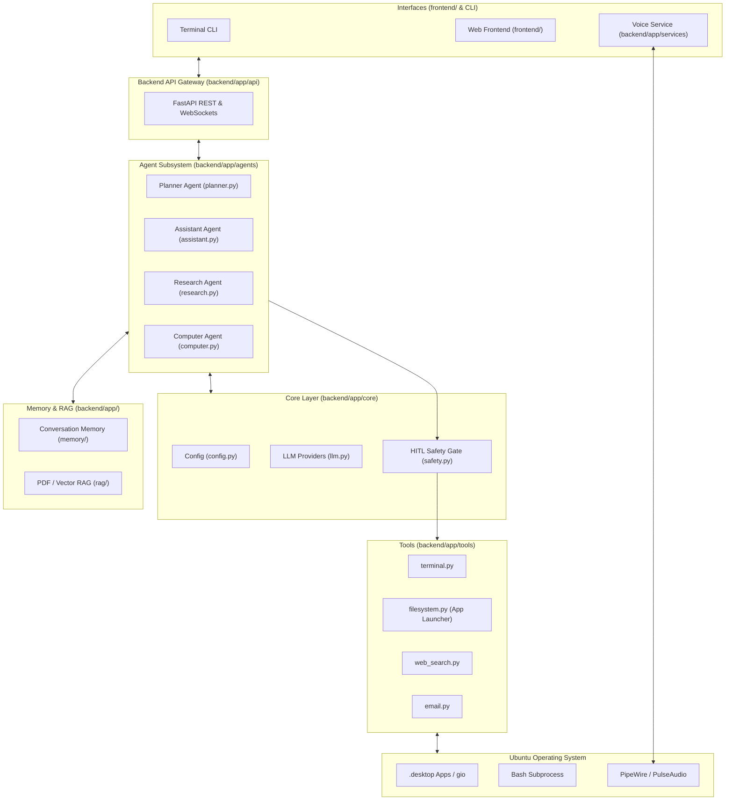

# JARVIS Architecture Specification

This document details the architectural blueprint of **JARVIS: A Personal AI Agent for Ubuntu**, matching the modular backend/frontend/infrastructure directory structure.

---

## 1. System Overview

JARVIS is built as a modular system separating frontend interfaces, backend agent services, and Ubuntu infrastructure.



---

## 2. Directory Layout & Module Responsibilities

```text
jarvis/
├── backend/
│   ├── app/
│   │   ├── api/                  # FastAPI routers (chat, sessions, tools, voice)
│   │   ├── agents/               # Specialist agents (assistant, research, computer, planner)
│   │   ├── core/                 # Config loader, LLM provider abstraction, safety guards
│   │   ├── tools/                # Terminal, filesystem, web search, email tools
│   │   ├── memory/               # SQLite history & session state
│   │   ├── rag/                  # PDF parsing, chunking, and vector Q&A
│   │   ├── workflows/            # Multi-agent LangGraph orchestration
│   │   ├── services/             # Audio, Voice (STT/TTS), and background workers
│   │   └── main.py               # FastAPI application entrypoint
│   ├── tests/                    # Backend automated tests
│   ├── Dockerfile                # Container definition
│   └── requirements.txt          # Python dependencies
├── frontend/                     # Web / Desktop user interface
├── infrastructure/               # Systemd units, Docker Compose, Ubuntu setup scripts
├── docs/                         # System architecture, roadmap, and specs
├── PROJECT_STATE.md              # Living state & agent handoff doc
└── README.md                     # Repository overview
```

---

## 3. Subsystem Breakdown

### 3.1 Agents (`backend/app/agents/`)
- **`assistant.py` (AssistantAgent):**
  - Primary persona in Phase 1.
  - Manages chat conversations, synthesizes context, and coordinates direct responses.
- **`research.py` (ResearchAgent):**
  - Specialist in Phase 2 for internet search and PDF synthesis.
  - Queries `web_search.py` and `rag/` document stores to produce factual reports.
- **`computer.py` (ComputerAgent):**
  - Specialist in Phase 3 for Ubuntu automation.
  - Handles application launching (`filesystem.py`) and bash command execution (`terminal.py`).
- **`planner.py` (PlannerAgent):**
  - Supervisor in Phase 6.
  - Decomposes high-level goals into dependency-ordered sub-tasks across specialist agents.

### 3.2 Tools (`backend/app/tools/`)
- **`terminal.py`:**
  - Subprocess runner with timeout, output capture, and risk scoring.
  - Requires explicit user approval for any state-modifying action (HITL).
- **`filesystem.py`:**
  - Scans `/usr/share/applications` and `~/.local/share/applications` for `.desktop` metadata.
  - Fuzzy-matches application names and launches them cleanly via `gio launch`.
- **`web_search.py`:**
  - Real-time internet search via DuckDuckGo / Tavily without breaking API limits.
- **`email.py`:**
  - Email draft creation and dispatch via SMTP/IMAP.

### 3.3 Core Engine (`backend/app/core/`)
- **`config.py`:** Central configuration loaded via `pydantic-settings` from `.env`.
- **`llm.py`:** Provider-agnostic abstraction for Ollama (local), Anthropic, OpenAI, and Gemini.
- **`safety.py`:** Command risk categorizer (Safe Read-Only vs Modifying vs Dangerous).

### 3.4 Memory & RAG (`backend/app/memory/` & `backend/app/rag/`)
- **Memory:** SQLite database storing `sessions`, `messages`, and contextual user preferences.
- **RAG:** PyMuPDF / pdfplumber document extraction, semantic chunking, and vector indexing.

### 3.5 Services (`backend/app/services/`)
- **Voice Subsystem:**
  - STT: `faster-whisper` for fast offline transcription.
  - TTS: `edge-tts` / `piper-tts` for natural vocal feedback.
  - Audio capture and playback via PulseAudio/PipeWire.

### 3.6 Workflows (`backend/app/workflows/`)
- LangGraph orchestration linking Planner, Assistant, Research, and Computer agents into a stateful, cyclic graph.
